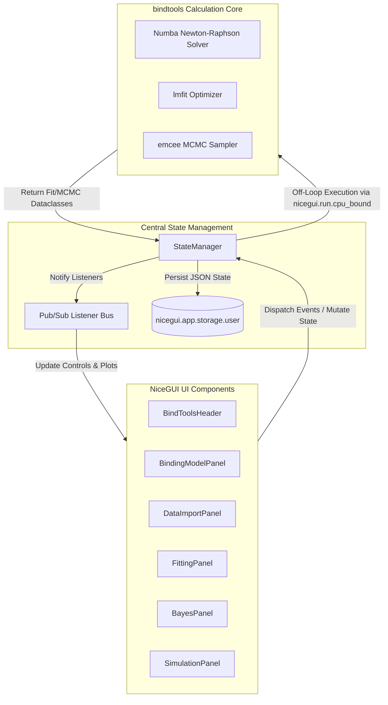
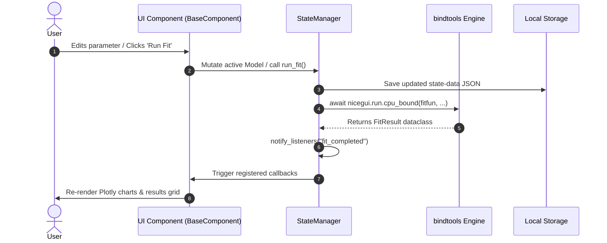
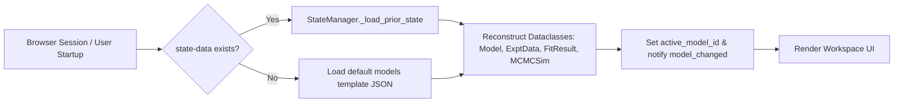

# Architecture Overview

`bindmc` is built as a state-decoupled web application utilizing NiceGUI for UI rendering and `bindtools` for numerical computations.

---

## High-Level Architecture Diagram



---

## Reactive Event Lifecycle (UI Event Bus)

When a user interacts with a control in the UI (for example, modifying an equilibrium equation or running a fit):



---

## State Persistence & Deserialization

All application state is serialized to dictionary representations (`to_dict()`) and stored in `nicegui.app.storage.user["state-data"]`.



---

## Directory Organization

```
bindmc/
├── src/bindmc/                  # Application code
│   ├── main.py                  # Entry point (NiceGUI runner / PyInstaller wrapper)
│   └── webgui/
│       ├── app.py               # BindToolsServer & page routing
│       ├── classes/             # Dataclass domain objects (Model, ExptData, FitResult)
│       ├── components/          # NiceGUI UI panel implementations
│       ├── state/
│       │   └── statemanager.py  # Central state bus
│       └── utils.py             # Equation parsing & matrix conversion helpers
├── bindtools/                   # Calculation engine package (submodule)
│   └── src/bindtools/
│       └── binding.py           # Numba speciation, lmfit fitting, emcee MCMC
├── tests/                       # Unit, UI, and integration tests
├── pyproject.toml               # Package configuration & dependencies
└── mkdocs.yml                   # Documentation configuration
```
